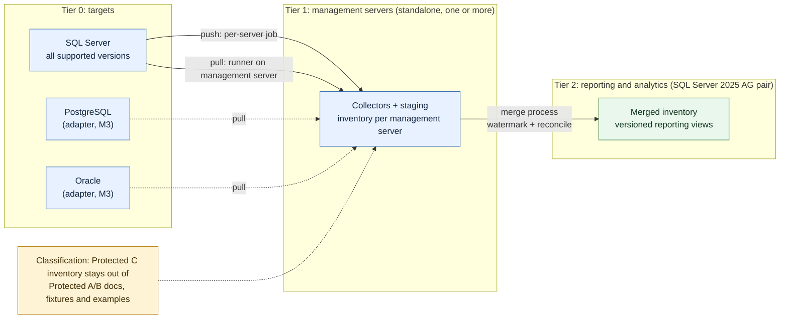

# CentralDB

> **Name:** README.md · **Purpose:** orientation for the CentralDB rebuild · **Version:** 0.1.0 · **Standard:** DBA Automation Engineering Standard v5.0.0 (UNVERIFIED, text not in repo, see ADR-0001) · **Author:** Your Friendly Neighbourhood DBA · **Date:** 2026-10-24

CentralDB is the central SQL Server inventory and monitoring database for the Government of Alberta Database Platform Services team: 1,300+ instances and 445 Availability Groups across Zone 4 and Zone 5, in Protected A/B and Protected C tiers. The team owns infrastructure, availability, performance and access management only, not application or data-side work.

**Status: the rebuild is being planned, not built.** This branch adds the workflow scaffold that the rebuild will run through: a workflow map, 14 slash commands, 3 read-only review agents, 3 skills, a deny-list and the first decision record. No rebuilt schema, collector or report exists yet, and nothing here has been run against a SQL Server instance. The v4 collectors and docs described in the old README are still in the repo as the legacy baseline; the old README is preserved at [docs/legacy-README-v4.md](docs/legacy-README-v4.md).

Tags used across the docs: `VERIFIED` (checked against a source on the stated date), `UNVERIFIED` (not checked), `DECISION` (needs a human call).

## Architecture being built

- **Tier 0:** the estate being inventoried. SQL Server on every supported version now; PostgreSQL and Oracle later through adapters (they need a driver, which is a proposal, not a dependency yet).
- **Tier 1:** standalone management servers that collect inventory. Collection runs per server (push) or from the management server (pull).
- **Tier 2:** the reporting and analytics server, a SQL Server 2025 AG pair. A merge process moves Tier 1 data here. Reports read versioned views.

## Start here

1. Read [docs/workflow-map.md](docs/workflow-map.md): phases, gates, artifacts and the current state of the rebuild.
2. In Claude Code, run `/cdb-status`. It reads the repo, refreshes the state section and names the next step.
3. Read [docs/decisions/ADR-0001-rebuild-strategy.md](docs/decisions/ADR-0001-rebuild-strategy.md) for the strategy and the open `DECISION` list.

## The workflow

Work moves through six gates in order, with no skipping: 1 Plan, 2 Develop, 3 Test, 4 Quality, 5 Version, 6 Deploy.

| Command | Purpose | Gate |
|---|---|---|
| `/cdb-status` | Report phase, branches, failing gates, next step | n/a |
| `/cdb-discover` | Inventory the legacy estate, dependency map, deletion proposal | 1 Plan |
| `/cdb-plan` | Plan card for one rebuild unit (`--approve` records the gate) | 1 Plan |
| `/cdb-schema` | DDL, rollback and a gated deploy wrapper | 2 Develop |
| `/cdb-collector` | Collector, worker and Agent job (push or pull) | 2 Develop |
| `/cdb-merge` | Tier 1 to Tier 2 merge with watermark and reconciliation | 2 Develop |
| `/cdb-views` | Versioned reporting-view contract | 2 Develop |
| `/cdb-migrate` | Old to new data migration with reconciliation | 2 Develop |
| `/cdb-test` | Pester and T-SQL assertion tests on a non-production target | 3 Test |
| `/cdb-quality` | Deny-list scan, conformance and score | 4 Quality |
| `/cdb-docs` | Per-script docs and the impacted-docs list | 5 Version |
| `/cdb-version` | Versions, changelog, ADRs, commit and PR text | 5 Version |
| `/cdb-deploy-plan` | Runbook, change request, rollback, Director summary. Never deploys | 6 Deploy |
| `/cdb-modernize-audit` | Re-check [modernization candidates](docs/modernization-candidates.md) | n/a |

Human gates are real stops: **G1** approve a plan, **G2** new schema or deny-list exception, **G3** pull request review, **G4** Director change approval (production only), **GD** approve deletions.

## Safety rules

- Report-only by default. Anything that changes state needs `-Apply`.
- Commands never target production. A target must be on `docs/nonprod-targets.md` (not created yet, `DECISION`) and must not look like a production listener, or you must type the confirmation line.
- No credentials in any file. Integrated authentication or gMSA only.
- Nothing is deleted without approval; see [docs/decisions/deletion-proposal.md](docs/decisions/deletion-proposal.md).
- Every generated script is checked against [docs/deny-list.md](docs/deny-list.md). One hit fails Lock 4.

## Requirements for rebuilt code

| Item | Rule | Status |
|---|---|---|
| PowerShell | 5.1 floor, 7.2 or later supported | Parse-checked on 5.1.26100 and 7.6.8 `VERIFIED 2026-10-24`; 7.2 itself `UNVERIFIED` |
| dbatools | Primary automation layer, installed from the UNC PSRepository only | 2.8.2 inspected on the author's workstation `VERIFIED 2026-10-24`; the minimum supported version is a `DECISION` |
| Other modules or drivers | Proposed first, never added silently | None added. PostgreSQL and Oracle drivers are proposals |
| SQL Server on Tier 0 and Tier 1 | Every supported version; features newer than the oldest supported version are version-gated | Support dates in [modernization candidates](docs/modernization-candidates.md) `VERIFIED 2026-10-24` |
| SQL Server on Tier 2 | 2025 AG pair | Edition (Enterprise or Standard) is a `DECISION` and changes the design |
| Environment | Air-gapped: no `Install-Module` from the internet, no runtime downloads | By rule |

## Repository map

| Path | What it is |
|---|---|
| `docs/workflow-map.md` | Master workflow map and the live rebuild state |
| `docs/decisions/` | ADRs and the deletion proposal |
| `docs/deny-list.md` | The Lock 4 deny-list |
| `docs/modernization-candidates.md` | Scored feature proposals |
| `docs/scripts/`, `docs/schemas/` | Per-script and per-schema docs (created by the Develop commands) |
| `.claude/commands/`, `.claude/agents/`, `.claude/skills/` | The workflow itself |
| `src/` | Rebuilt code, created by the Develop commands (does not exist yet) |
| `Collect/`, `SQL/`, `CentralDB/`, `CentralDB_Reports/`, `Original/`, `OlaHallengren/`, `Tests/` | Legacy v4 baseline, untouched |
| `docs/SETUP.md`, `docs/SQL-AGENT-JOBS.md`, `docs/TESTING.md`, `docs/SCRIPT-REFERENCE.md`, `CentralDB-Ops-Runbook.md` | Legacy v4 documentation, kept as reference until `/cdb-docs` replaces them |

## What is not done yet

- No rebuilt object has been executed on any instance; templates are parse-checked only.
- The v5.0.0 standard text is not in the repo, so conformance is checked against the brief's constraints.
- Open decisions are listed in ADR-0001, section 8.
