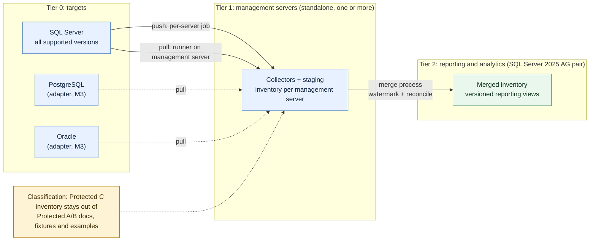
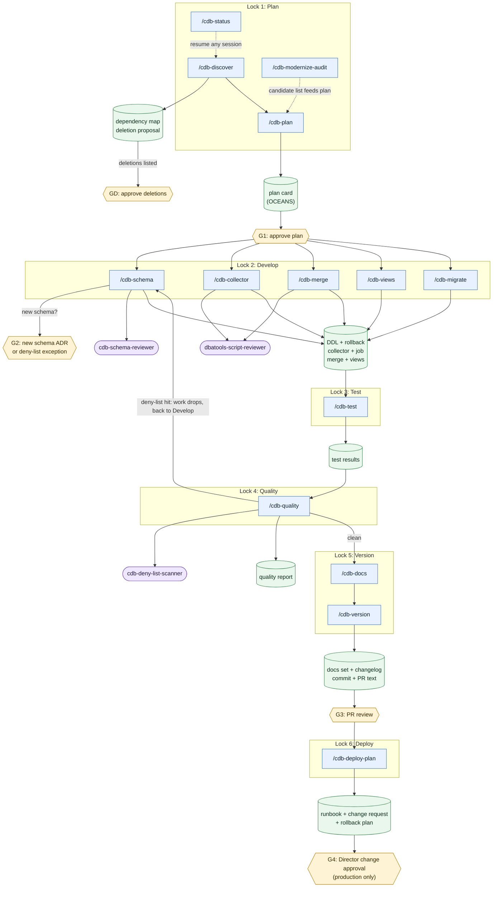

# CentralDB rebuild: workflow map

> **Name:** workflow-map.md · **Purpose:** master map of the CentralDB rebuild workflow (phases, commands, agents, gates, artifacts) · **Version:** 0.1.0 · **Standard:** DBA Automation Engineering Standard v5.0.0 (UNVERIFIED, v5.0.0 text not in repo, see ADR-0001) · **Author:** Your Friendly Neighbourhood DBA · **Date:** 2026-10-24

Tags used in this document: `VERIFIED` (checked against a source this session), `UNVERIFIED` (not checked), `DECISION` (needs a human call).

## 1. How to use this map

Primary reader is Claude Code in a later session with no memory of this one. Start with `/cdb-status`. It reads the repo, rewrites section 9 below, and names the next command. Every command is self-contained: it states its inputs, preconditions and exit check, and it ends by naming the next command.

Rules that apply to every command (full text in `CLAUDE.md`, section "CentralDB rebuild"):

- Report-only by default. Anything that changes state requires `-Apply` and only on a non-production target.
- Production is never a target. A target that is not in `docs/nonprod-targets.md` is refused unless the user types `CONFIRM-TARGET: <exact target>` in the current session. `DECISION`: that allow-list file does not exist yet, and I need the list from you.
- Human gates are real stops. The command prints the decision needed and ends.
- Nothing is deleted. Deletions are proposed in `docs/decisions/deletion-proposal.md` and wait for approval (gate GD).
- Deny-list: `docs/deny-list.md`. One hit fails Lock 4.

## 2. Topology the workflow builds for

Source: intake answers recorded in `docs/decisions/ADR-0001-rebuild-strategy.md`.

`DECISION`: whether Protected A/B and Protected C data share one Tier 2 AG pair or need separate pairs and separate management servers. The intake did not say. `/cdb-plan` must record the answer per rebuild unit before any merge design is approved.

## 3. Workflow flowchart

Agents are read-only reviewers called from inside commands. They never sit on the critical path alone: a command that calls an agent still owns the exit check.

## 4. Human gates

| Gate | Where | Decision needed | Who |
|---|---|---|---|
| G1 | after `/cdb-plan` | Approve the OCEANS plan card for one rebuild unit | You |
| G2 | during `/cdb-schema` (conditional) | Approve the ADR for a new schema, or a deny-list exception | You |
| G3 | after `/cdb-version` | Review the PR. Claude never merges | You |
| G4 | after `/cdb-deploy-plan` | Director-level change approval. Production only. Non-production deployments need G1 to G3 only | Director |
| GD | any command that finds something to remove | Approve a deletion list. Nothing is deleted before this | You |

## 5. Phase table

LOCKS gate numbering follows the brief: 1 Plan, 2 Develop, 3 Test, 4 Quality, 5 Version, 6 Deploy. "n/a" means the command sits outside the gate sequence.

| Phase | Slash command | Inputs | Outputs | Exit check | Human gate (Y/N) | LOCKS gate |
|---|---|---|---|---|---|---|
| Orient | `/cdb-status` | repo, git state | refreshed section 9 of this file, next-step report | section 9 rewritten, next command named | N | n/a |
| Discover | `/cdb-discover` | repo, optional existing inventory export | `docs/rebuild/discovery/dependency-map.md`, baseline deny-list findings for legacy code, `docs/decisions/deletion-proposal.md` | every schema, view, proc, job and collector listed once, deletions only proposed | Y (GD for deletions) | 1 Plan |
| Plan | `/cdb-plan` | rebuild unit name, discovery output | `docs/rebuild/plans/<unit>.md` OCEANS card with `Status: DRAFT` | card complete, no empty section, classification and tier stated | Y (G1) | 1 Plan |
| Build schema | `/cdb-schema` | approved plan card | `src/sql/<schema>/` DDL, rollback script, `docs/schemas/<schema>.md` | DDL parses, rollback present, `cdb-schema-reviewer` has no blocking finding | Y (G2 if new schema) | 2 Develop |
| Build collector | `/cdb-collector` | approved plan card, platform, non-production target | `src/powershell/` function, Agent job script with rollback, `docs/scripts/<Name>.md` | parses on PS 5.1 and 7.2+, `dbatools-script-reviewer` has no blocking finding | N | 2 Develop |
| Build merge | `/cdb-merge` | approved plan card, management server and reporting server names from the allow-list | merge function, merge job script with rollback, reconciliation queries, `docs/scripts/<Name>.md` | idempotent by design, watermark and reconcile present, parses | N | 2 Develop |
| Build views | `/cdb-views` | approved plan card, consumer list | versioned reporting views in `src/sql/rpt/`, view contract doc | no `SELECT *`, every column named, version suffix present | N | 2 Develop |
| Build migrate | `/cdb-migrate` | approved plan card, old and new schema names | migration script with row-count and checksum reconciliation, `-Apply` gated | report-only default confirmed, reconciliation present | N | 2 Develop |
| Test | `/cdb-test` | unit name, non-production target | Pester and T-SQL assertion tests under `Tests/`, results summary | tests parse, run against the named non-production target only, results recorded | N | 3 Test |
| Quality | `/cdb-quality` | unit name | `docs/rebuild/quality/<unit>.md` with deny-list result, conformance result, score | zero deny-list hits, otherwise the work drops back to Develop | N | 4 Quality |
| Docs | `/cdb-docs` | unit name or `all` | regenerated per-script docs, impacted-doc list | every script has a doc, every impacted doc is listed | N | 5 Version |
| Version | `/cdb-version` | unit name | version headers, `CHANGELOG.md` entry, ADRs, commit and PR text | Lock 4 clean on the final tree, changelog entry present | Y (G3 at PR) | 5 Version |
| Deploy plan | `/cdb-deploy-plan` | unit name, target environment | runbook, change-request text, rollback plan, one-page Director summary | summary readable in under five minutes, rollback present, nothing executed | Y (G4, production only) | 6 Deploy |
| Audit | `/cdb-modernize-audit` | central instance version, `docs/modernization-candidates.md` | updated candidate scores and recommendations | every candidate re-tagged `VERIFIED` or `UNVERIFIED` with a date | N | n/a |

## 6. Artifact map

| Artifact | Path | Written by |
|---|---|---|
| This map | `docs/workflow-map.md` | scaffold, section 9 by `/cdb-status` |
| Deny-list | `docs/deny-list.md` | scaffold |
| Modernization candidates | `docs/modernization-candidates.md` | scaffold, `/cdb-modernize-audit` |
| ADRs | `docs/decisions/ADR-nnnn-*.md` | `/cdb-plan`, `/cdb-version` |
| Deletion proposal | `docs/decisions/deletion-proposal.md` | `/cdb-discover` |
| Discovery output | `docs/rebuild/discovery/` | `/cdb-discover` |
| Plan cards | `docs/rebuild/plans/<unit>.md` | `/cdb-plan` |
| Quality reports | `docs/rebuild/quality/<unit>.md` | `/cdb-quality` |
| Test results | `docs/rebuild/test-results/<unit>.md` | `/cdb-test` |
| Impact analysis | `docs/rebuild/impact/<unit>.md` | `/cdb-docs` |
| Release and PR text | `docs/rebuild/release/<unit>.md` | `/cdb-version` |
| Deploy plans | `docs/rebuild/deploy/<unit>-<environment>.md` | `/cdb-deploy-plan` |
| Changelog | `CHANGELOG.md` | `/cdb-version` |
| Non-production allow-list | `docs/nonprod-targets.md` | you (DECISION: file not created, I do not have the names) |
| New SQL | `src/sql/<schema>/` | `/cdb-schema`, `/cdb-views`, `/cdb-migrate` |
| New PowerShell | `src/powershell/` | `/cdb-collector`, `/cdb-merge` |
| Agent job scripts | `src/jobs/` | `/cdb-collector`, `/cdb-merge` |
| Tests | `Tests/Pester/`, `Tests/Sql/` | `/cdb-test` |
| Script docs | `docs/scripts/<Verb-DbtNoun>.md` | every Develop command, `/cdb-docs` |
| Schema docs | `docs/schemas/<schema>.md` | `/cdb-schema`, `/cdb-docs` |

The legacy tree (`Collect/`, `SQL/`, `CentralDB/`, `CentralDB_Reports/`, `Original/`) is left in place. New work goes under `src/`. `DECISION`: confirm `src/` as the home for rebuilt code.

When a script touches more than one functional area, its doc lists every impacted file from this checklist: its own `docs/scripts/` file, the `docs/schemas/` file of each schema it reads or writes, `docs/SCRIPT-REFERENCE.md`, `docs/SQL-AGENT-JOBS.md` if it has an Agent job, `docs/TESTING.md` if it adds tests, `README.md` and `CentralDB-Ops-Runbook.md` if architecture or operations change, and the `docs/rebuild/plans/<unit>.md` card.

## 7. Rebuild units and milestones

`DECISION`: unit boundaries are proposed here and become final at `/cdb-plan` and G1.

| Milestone | Units | Notes |
|---|---|---|
| M1 | `svr-core`, `inst-core`, `run-log`, `rpt-views-v1` | Target list from the inventory, per-instance run log, first versioned reporting views. SQL Server targets only |
| M2 | `inst-commandlog` (sliding-window partitioning), `ag`, `backup` | `Inst.CommandLog` exists in the legacy create script as the Ola Hallengren table and has no sliding window today `VERIFIED` (repo inspected this session) |
| M3 | `security`, `audit`, `cache`, `platform-postgres`, `platform-oracle` | New schemas need an ADR each. Postgres and Oracle adapters wait for the driver decision in `docs/modernization-candidates.md` |

## 8. Constraints that shape every unit

- SQL Server 2025 features are available on Tier 2 only. Tier 1 management servers and Tier 0 targets are version-unknown, so Tier 1 code uses only features present on every supported version, and anything newer is gated by a version check and tagged.
- Supported-version baseline, `VERIFIED` against Microsoft Lifecycle pages on 2026-10-24: 2016 extended support ended 2026-07-15 (Extended Security Updates year 1 runs to 2027-07-13), 2017 ends 2027-10-13, 2019 ends 2030-01-09, 2022 ends 2033-01-12. The 2025 dates were not checked `UNVERIFIED`.
- dbatools is the primary automation layer. PostgreSQL and Oracle cannot use it. Any driver is a proposed dependency and needs your approval first. Modules come from the UNC PSRepository only.
- Reporting and analytics edition `DECISION`: Basic availability groups (Standard) allow two replicas and one database. Contained AGs are Enterprise only `VERIFIED`. The edition of the 2025 AG pair decides which designs are possible.

## 9. State of the rebuild

`/cdb-status` rewrites everything between the two markers. Do not edit by hand.

<!-- CDB-STATE:BEGIN -->
**Last refreshed:** 2026-10-24 by the scaffold pass (not yet by `/cdb-status`)

| Item | Value |
|---|---|
| Overall phase | Workflow scaffold built, awaiting G3 (PR review) |
| Work branch | `claude/cdb-workflow-scaffold` |
| Open PR | see the PR opened from the branch above |
| Failing gates | none known. Lock 4 scan over scaffold files: see PR description |
| Unit progress | none started |

| Unit | Lock reached | Plan card | Last command | Blocker |
|---|---|---|---|---|
| `svr-core` | none | none | none | needs `/cdb-discover` |
| `inst-core` | none | none | none | needs `/cdb-discover` |
| `run-log` | none | none | none | needs `/cdb-discover` |
| `rpt-views-v1` | none | none | none | needs `/cdb-discover` |

**Next recommended command:** review and merge the scaffold PR (G3, yours), then run `/cdb-discover`.
<!-- CDB-STATE:END -->
